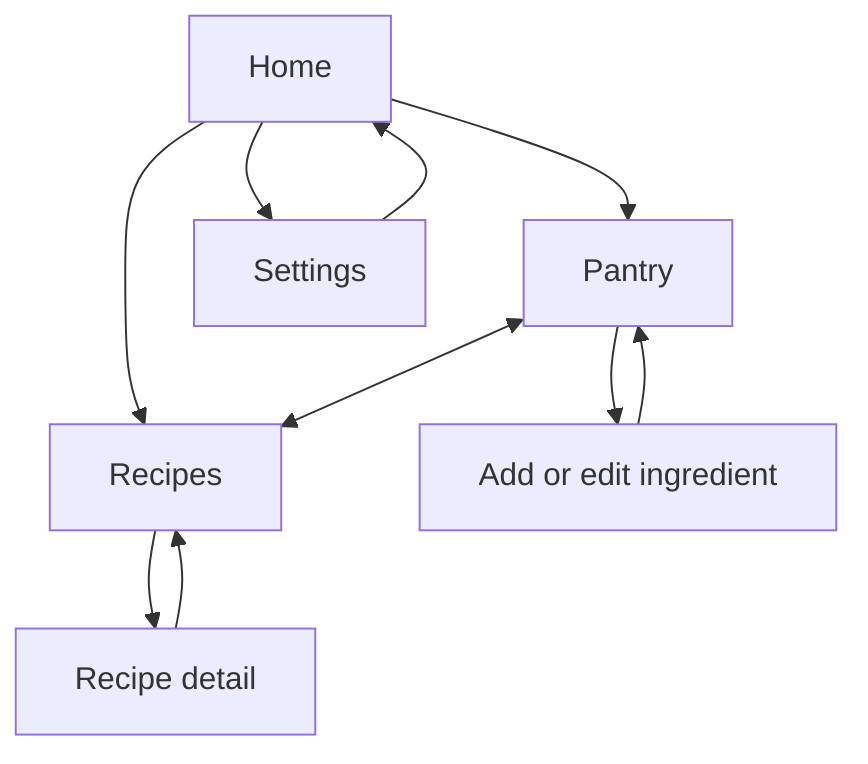

# Database design

```mermaid
erDiagram
  pantry_items { INTEGER id PK "name quantity unit expiry"; TEXT name; TEXT normalized_name; REAL quantity; TEXT unit; TEXT expiry_date }
  recipes ||--|{ recipe_ingredients : requires
  recipes { INTEGER id PK; TEXT name UK; TEXT description; TEXT instructions; INTEGER preparation_time }
  recipe_ingredients { INTEGER id PK; INTEGER recipe_id FK; TEXT ingredient_name; TEXT normalized_name; REAL quantity; TEXT unit }
```

The SQLiteOpenHelper is `DatabaseHelper.java`. `pantry_items` stores user records and remains empty after initial installation. `recipes` and `recipe_ingredients` store exactly 20 built in recipes. The relationship uses `ON DELETE CASCADE`; foreign keys are enabled in `onConfigure`. Name and recipe foreign key indexes support reads. Positive quantities are enforced by SQL `CHECK` constraints and form validation.

Recipe inserts run inside a transaction during the database's first `onCreate`. Fixed recipe IDs and a unique recipe name prevent duplicate recipe rows. A future version must use a non destructive `onUpgrade` migration to preserve the pantry. This version has no schema migration because its schema version is 1.


